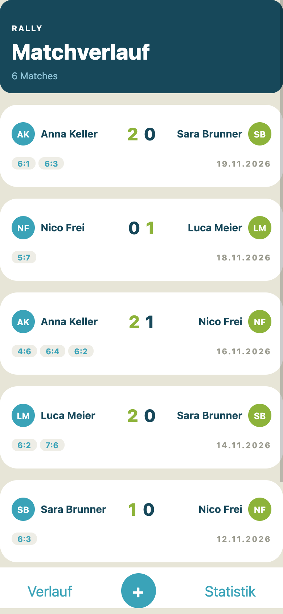
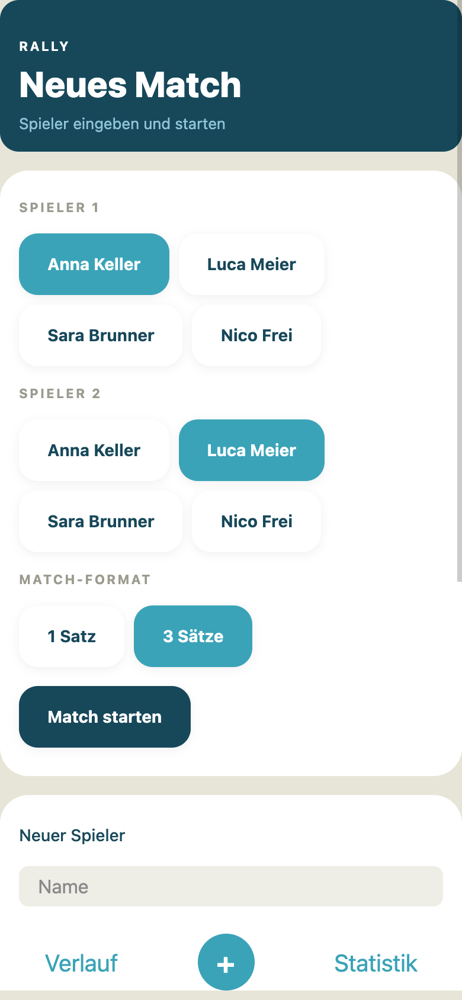
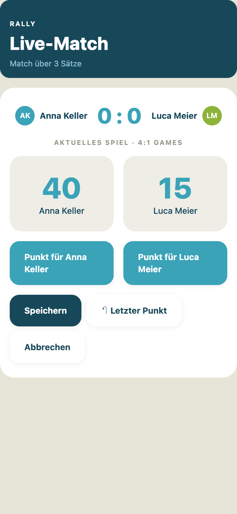
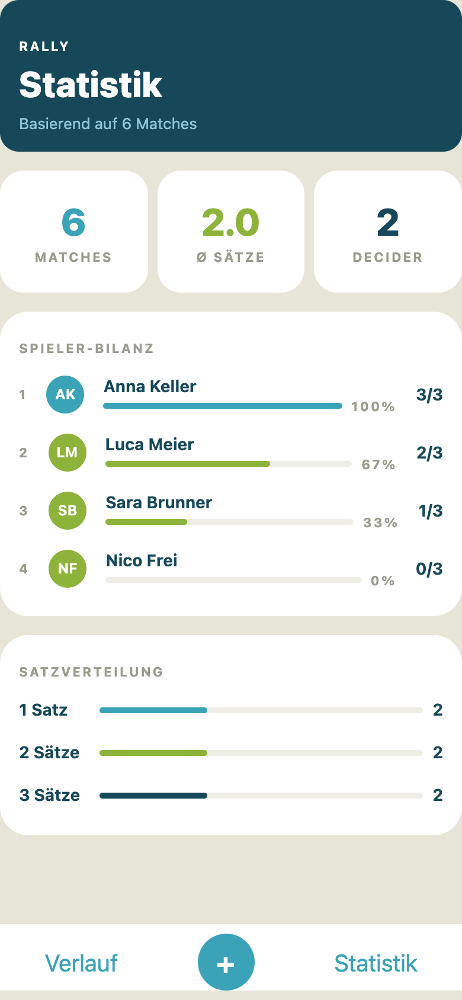

# Tennis App "Rally" 🎾

Mobile App zum Erfassen und Verwalten von Tennis-Matches. Trainer behalten den Überblick über mehrere Spiele und Spieler gleichzeitig – Ergebnisse werden automatisch mitgezählt.

## Features

- **Matchverlauf** – Übersicht aller vergangenen Matches mit Satzresultaten
- **Neues Match** – Spieler erfassen (max. 20 Zeichen, keine Duplikate) oder löschen, zwei Spieler und das Format (1 oder 3 Sätze) wählen
- **Live-Match** – eigener Screen: Punkte werden nach Tennisregeln gezählt (Einstand/Vorteil, Tiebreak bei 6:6). Den letzten Punkt kann man rückgängig machen. Das Match endet automatisch oder wird manuell per "Speichern" beendet
- **Statistik** – Spielerbilanz, Ø Sätze pro Match, Decider und Satzverteilung über alle erfassten Matches

## Screenshots

| Verlauf | Neues Match | Live-Match | Statistik |
| --- | --- | --- | --- |
|  |  |  |  |

## Setup

Voraussetzungen: Node.js (LTS) und npm. Für Mobile zusätzlich die App **Expo Go** oder ein iOS-Simulator bzw. Android-Emulator.

```bash
npm install
npx expo start
```

Danach im Terminal `w` für den Browser drücken (http://localhost:8081), `i` für den iOS-Simulator oder `a` für Android. Alternativ den QR-Code mit Expo Go scannen.

## Scripts

| Befehl | Beschreibung |
| --- | --- |
| `npm start` | Startet den Expo-Dev-Server |
| `npm run web` | Startet direkt im Browser |
| `npm run ios` | Startet im iOS-Simulator |
| `npm run android` | Startet im Android-Emulator |
| `npm run lint` | Prüft den Code mit ESLint (`expo lint`) |

## Architektur

Expo (SDK 57) mit **Expo Router** (dateibasiertes Routing) und TypeScript. Die Daten liegen lokal in **AsyncStorage**. Ein Backend gibt es nicht.

```
src/
├── app/                    Screens (jede Datei = eine Route)
│   ├── _layout.tsx         Root-Stack: Tabs + Live-Match
│   ├── match.tsx           Live-Match (eigener Stack-Screen, Zurück-Navigation)
│   └── (tabs)/
│       ├── _layout.tsx     Eigene Tab-Leiste: Verlauf · + · Statistik
│       ├── index.tsx       Matchverlauf
│       ├── new-match.tsx   Spieler verwalten, Match konfigurieren
│       └── statistics.tsx  Statistik
├── components/             Wiederverwendbare UI-Bausteine
│                           (Card, HeaderCard, PillButton, Avatar, MatchCounter, MatchForm, …)
├── hooks/
│   └── use-match-data.ts   Lädt Spieler und Matches beim Fokus eines Screens, inkl. isLoading/error
├── lib/                    Logik ohne UI
│   ├── database.ts         Speicherzugriff (AsyncStorage), Migration alter Datenformate
│   ├── tennis-scoring.ts   Zählregeln: Punkte, Games, Sätze, Tiebreak
│   └── stats.ts            Berechnung der Statistiken
└── constants/theme.ts      Farben, Abstände, maximale Inhaltsbreite
```

**Datenfluss:** Screens holen die Daten über `useMatchData()` und schreiben über die Funktionen in `lib/database.ts`. Die Logik in `lib/` ist reines TypeScript ohne React und lässt sich deshalb getrennt von der UI testen.

**Navigation:** Unter `/new-match` werden die Spieler und das Format gewählt. "Match starten" öffnet `/match?player1Id=…&player2Id=…&bestOf=…` als eigenen Screen auf dem Stack. Nach dem Speichern führt `router.dismissTo('/')` zurück zum Verlauf. "Abbrechen", die Zurück-Geste oder der Browser-Zurück-Button schliessen das Match, ohne zu speichern.

## Bekannte Probleme

- **Nur lokale Daten:** AsyncStorage speichert pro Gerät bzw. Browser. Es gibt keine Synchronisation und kein Backup. Wer die Browserdaten löscht, verliert alle Matches.
- **Laufendes Match ist flüchtig:** Der Spielstand wird erst beim Speichern geschrieben. Wer den Live-Match-Screen verlässt oder die Seite neu lädt, verliert das laufende Match. Eine Rückfrage gibt es nicht.
- **Kein Bearbeiten/Löschen von Matches:** Gespeicherte Matches lassen sich nicht mehr ändern.
- **Gelöschte Spieler:** Ihre Matches bleiben erhalten und erscheinen als "Gelöschter Spieler". In der Spielerbilanz fehlen sie.
- **Manuell beendete Matches bei Satzgleichstand** (z. B. 1:1) haben keinen Sieger und zählen in der Bilanz weder als Sieg noch als Niederlage.
- **Nur helles Farbschema**, Dark Mode wird nicht unterstützt.
- App-Icon und Splashscreen sind noch die Standardbilder von Expo. In `package.json` stehen noch Pakete aus dem Expo-Template, die der Code nicht direkt importiert.

## Team & Aufgabenteilung

| Person | Beiträge |
| --- | --- |
| **Anya Zettel** | HeaderCard, Tab-Navigation und Screen-Layout, Statistik-Logik und -Ansicht, Aufteilung von Verlauf und Neues Match, Design-Überarbeitung (Avatare, Karten, Farben, Statistik-UI) |
| **Michael Schädler** | Datenbank mit AsyncStorage inkl. Beispieldaten und Migration, Match-Formular, Match-Counter und Tennis-Zähllogik, Clean-Code-Refactoring, Spieler erfassen und löschen, Speichern und Satzverteilung, Live-Match-Screen, Ladezustand, Undo, README |

## Konzept

Figma-Board: https://www.figma.com/board/XfwdgLrKxK0ylajWw8dXTx/Tennis-App-%22Rally%22?node-id=0-1&t=tqXRuKaG8XtYz3Sj-1
